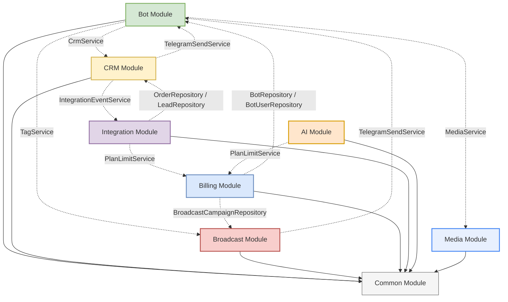
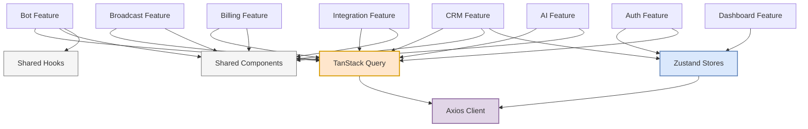

# Launchly — Module Relationships

This document details the communication paths and dependency directions between backend modules, frontend modules, and their client-server API mappings.

---

## ☕ Backend Dependency Graph

The diagram below represents the directed flow of dependency and invocation between Java modules:

---

## ⚛️ Frontend Dependency Graph

The diagram below shows how the client-side feature domains, shared UI components, global Zustand stores, and React Query clients interact:

---

## 🔌 Client-Server API Mappings

The frontend features coordinate directly with their corresponding backend controllers. The table below maps each frontend domain to its REST API entry points and real-time triggers:

| Frontend Feature | Backend Target Controller | REST API Paths | WebSocket / Real-Time Channel |
|---|---|---|---|
| **`auth`** | `AuthController` | `/api/v1/auth/*` | *None* |
| **`bot`** | `BotController` | `/api/v1/bots/*` | *None* |
| **`crm`** | `CrmController` | `/api/v1/crm/*` | `/topic/crm/{botId}/orders` `/topic/crm/{botId}/leads` `/topic/crm/{botId}/messages` |
| **`broadcast`** | `BroadcastController` | `/api/v1/broadcast/*` | *None* |
| **`billing`** | `BillingController` | `/api/v1/billing/*` | *None* |
| **`integration`** | `IntegrationController` | `/api/v1/integrations/*` | *None* |
| **`ai`** | `AiController` | `/api/v1/ai/*` | *None* |

---

## Module Interaction Details

### 1. Bot Module ➔ CRM Module (`bot` depends on `crm` interface)
* **Purpose**: Persist user orders, lead generation captures, and chat history created during flow execution.
* **Mechanism**:
  * `OrderNodeExecutor` injects `CrmService` and calls `createOrder` to log new transactions.
  * `LeadNodeExecutor` injects `CrmService` and calls `createLead` to register customer contact profiles.
  * `BotUpdateHandler` injects `CrmService` and calls `saveIncomingMessage` to capture raw user text logs for owner view.
* **Boundary Rule**: The `bot` module depends ONLY on the service interface `CrmService`. It does not access CRM repositories or DB configurations directly.

### 2. Bot Module ➔ Broadcast Module (`bot` depends on `broadcast` interface)
* **Purpose**: Apply audience segmentation tags to users during flow execution.
* **Mechanism**:
  * `TagNodeExecutor` handles `TAG` flow nodes by injecting `TagService` and calling `getOrCreateTag` to associate user profiles with segment labels.
* **Boundary Rule**: The `bot` module uses the `TagService` interface for label mappings. It has no visibility into broadcast scheduling or campaign statistics.

### 3. CRM Module ➔ Bot Module (`crm` depends on `bot` interface)
* **Purpose**: Dispatch replies typed by the bot owner inside the CRM workspace back to the customer's Telegram account.
* **Mechanism**:
  * `CrmServiceImpl` injects `TelegramSendService` and invokes `sendMessage`.
* **Boundary Rule**: To avoid circular dependencies and modular leakage, the CRM module must NEVER invoke `TelegramBotManager` directly. It delegates dispatches to `TelegramSendService`.
* **Circular Reference Protection**: In `TelegramSendService`, the reference to `TelegramBotManager` is annotated with Spring's `@Lazy` annotation. This breaks the startup cycle cleanly.

### 4. Broadcast Module ➔ Bot Module (`broadcast` depends on `bot` interface)
* **Purpose**: Deliver bulk marketing campaign messages to targeted Telegram users.
* **Mechanism**:
  * `BroadcastScheduler` executes campaign dispatches by querying target users and sending bulk messages via `TelegramSendService.sendMessage`.
* **Boundary Rule**: The broadcast module has no direct coupling with Telegram API client wrappers or webhook contexts. It offloads all messaging activities to `TelegramSendService`.

### 5. CRM Module ➔ Integration Module (`crm` depends on `integration` interface)
* **Purpose**: Asynchronously notify external services (Google Sheets, Webhooks) when key business actions occur (order created, lead captured).
* **Mechanism**:
  * `CrmServiceImpl` injects `IntegrationEventService` and invokes `onOrderCreated` or `onLeadCreated`.
* **Boundary Rule**: CRM services only fire events; they do not process the actual sheets sync or webhook dispatching, ensuring CRM performance is not impacted by third-party latency.

### 6. Integration Module ➔ Billing & CRM Modules (`integration` depends on `billing` & `crm`)
* **Purpose**: Ensure integration requests conform to billing limits and sync correct transaction details.
* **Mechanism**:
  * `IntegrationServiceImpl` injects `PlanLimitService` to invoke `checkIntegrationAccess` before configurations are saved.
  * `IntegrationEventServiceImpl` injects `OrderRepository` and `LeadRepository` to fetch fully hydrated entities and formats them as rows/payloads.
* **Boundary Rule**: The integration module uses the CRM model structure to build JSON payloads and spreadsheet cells, but does not modify CRM state or records directly.

### 7. AI Module ➔ Billing Module (`ai` depends on `billing`)
* **Purpose**: Enforce feature access limits before executing AI completions.
* **Mechanism**:
  * `AiServiceImpl` injects `PlanLimitService` and invokes `checkAiAccess` to verify if the owner's active plan allows AI features.
* **Boundary Rule**: The AI module resides independently from billing rules and only queries the billing module interface `PlanLimitService` for state validation.

### 8. Billing Module ➔ Bot & Broadcast Modules (`billing` depends on `bot` & `broadcast` repositories)
* **Purpose**: Enforce user limits checks dynamically based on the numbers of existing objects.
* **Mechanism**:
  * `PlanLimitServiceImpl` injects `BotRepository`, `BotUserRepository`, and `BroadcastCampaignRepository` to verify bot counts, active user counts, and monthly broadcast counts.
* **Boundary Rule**: The billing module uses repository count queries to protect limit boundaries, but it does not invoke or configure bot executions or broadcast schedules.

### 9. Bot Module ➔ Media Module (`bot` depends on `media` interface)
* **Purpose**: Cleanup unused storage assets when owners change or delete bot avatars.
* **Mechanism**:
  * `BotServiceImpl` injects `MediaService` and calls `delete(...)` when a bot's new avatar URL differs from the saved one and an old `avatarPublicId` is present in the database.
* **Boundary Rule**: The bot module depends only on the `MediaService` interface and doesn't know the specifics of the storage provider (Cloudinary). The `media` module is completely decoupled and does not reference any bot domain packages.
