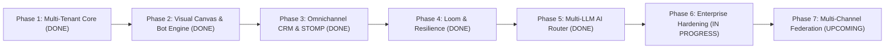

# Launchly Engineering Roadmap

Phased implementation roadmap for the **Launchly** enterprise platform, tracking foundational architecture, scale milestones, and upcoming capabilities.

---

## Milestone Flowchart

---

## Phase 1: Multi-Tenant Architecture & Security Baseline [COMPLETED]
> **Goal:** Establish secure multi-workspace tenancy, database migrations, and authentication.

- [x] **Step 1.1**: Spring Security 7 stateless JWT token engine with refresh token rotation.
- [x] **Step 1.2**: Liquibase zero-downtime database migration baseline (54 versioned scripts).
- [x] **Step 1.3**: Multi-tenant workspace RBAC model (`OWNER`, `ADMIN`, `MEMBER`, `AGENT`).
- [x] **Step 1.4**: Google OAuth2 SSO integration.
- [x] **Step 1.5**: Automated PII masking in application logs (`PIIMaskingFilter`).

---

## Phase 2: Visual Canvas & Conversational Engine [COMPLETED]
> **Goal:** Interactive flow builder with high-throughput execution on PostgreSQL JSONB.

- [x] **Step 2.1**: Hybrid relational + `JSONB` schema model for dynamic flow graph storage.
- [x] **Step 2.2**: React Flow (`@xyflow/react`) visual graph builder with custom node types.
- [x] **Step 2.3**: Polymorphic `NodeExecutor` engine in backend handling Messages, Conditions, and Actions.
- [x] **Step 2.4**: Telegram Bot API webhook listener with cryptographic secret token validation.
- [x] **Step 2.5**: Sub-flow call stack manager (`BotCallStackManager`).

---

## Phase 3: Omnichannel CRM & Real-Time Live Inbox [COMPLETED]
> **Goal:** Seamless two-way customer communication with human takeover capabilities.

- [x] **Step 3.1**: STOMP over WebSocket infrastructure (`/topic/crm/{botId}/messages`).
- [x] **Step 3.2**: Human operator interruption protocol (`is_operator_controlled` flag).
- [x] **Step 3.3**: Virtualized message thread and contact list rendering (TanStack Virtual).
- [x] **Step 3.4**: Lead stage pipeline with automated qualification scoring.

---

## Phase 4: High-Concurrency Resilience & Loom [COMPLETED]
> **Goal:** Sub-millisecond queue execution and fault tolerance under heavy load.

- [x] **Step 4.1**: Migration to Java 21 Project Loom virtual threads (`spring.threads.virtual.enabled=true`).
- [x] **Step 4.2**: Transactional Outbox pattern with automated DLQ re-drive mechanism.
- [x] **Step 4.3**: Redis distributed idempotency aspect (`@Idempotent`) on financial/mutation endpoints.
- [x] **Step 4.4**: Tier-based dynamic token bucket rate limiter (`TierRateLimitFilter`).
- [x] **Step 4.5**: Deep JPA Entity Graphs and automatic JDBC batching (size=50).

---

## Phase 5: Multi-Provider AI Fallback Router [COMPLETED]
> **Goal:** Zero-downtime conversational AI generation.

- [x] **Step 5.1**: Multi-provider failover ladder (Groq $\to$ Gemini $\to$ OpenRouter $\to$ Cerebras).
- [x] **Step 5.2**: Resilience4j circuit breakers on external HTTP clients.
- [x] **Step 5.3**: Text-to-Bot graph generator using LLM structured outputs.
- [x] **Step 5.4**: Cloudflare Turnstile anti-bot verification securing auth and AI endpoints.

---

## Phase 6: Enterprise Hardening & Observability [IN PROGRESS]
> **Goal:** Comprehensive engineering documentation, load verification, and SOC-2 readiness.

- [x] **Step 6.1**: Formal STRIDE Threat Model (`docs/THREAT_MODEL.md`) and GDPR spec (`docs/PRIVACY.md`).
- [x] **Step 6.2**: Loom Concurrency Specification (`docs/CONCURRENCY.md`) and Disaster Recovery Runbook (`docs/FAILURES_AND_RECOVERY.md`).
- [x] **Step 6.3**: Standardized ADR registry (`docs/adr/ADR-001..010`).
- [ ] **Step 6.4**: Distributed OpenTelemetry tracing integration with Grafana Tempo.
- [ ] **Step 6.5**: Automated outbox archival scheduler for cold storage.

---

## Phase 7: Multi-Channel Federation [UPCOMING]
> **Goal:** Expand bot execution engine beyond Telegram to WhatsApp Business and Instagram Direct.

- [ ] **Step 7.1**: Meta Cloud API connector and webhook ingestion pipeline.
- [ ] **Step 7.2**: Universal message schema abstraction across Telegram and WhatsApp.
- [ ] **Step 7.3**: Omnichannel unified CRM inbox supporting cross-platform contact merging.
