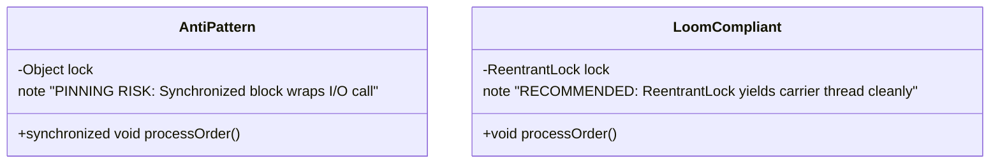
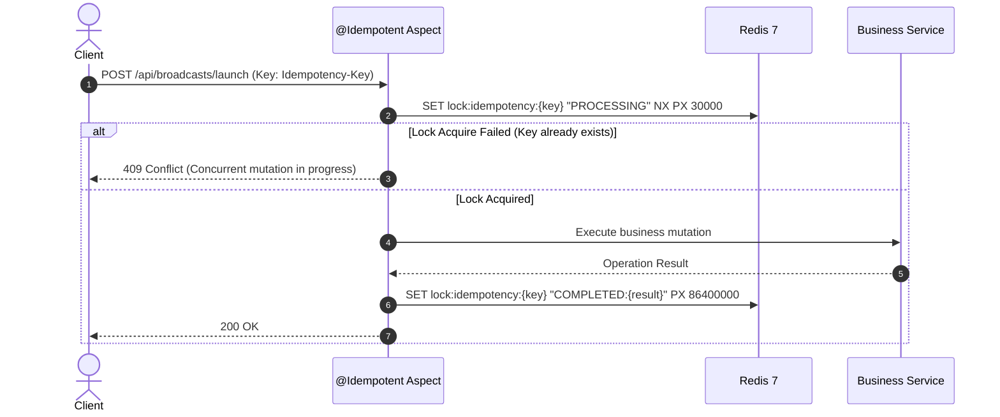

# Concurrency, Threading & Resource Architecture

| Metadata | Value |
|---|---|
| Target Platform | Java 21 LTS (OpenJDK) |
| Framework | Spring Boot 4.0.6 / Spring Framework 7.x |
| Execution Engine | Project Loom Virtual Threads (`spring.threads.virtual.enabled=true`) |
| Threading Isolation | Non-blocking Virtual Threads + Redis Distributed Locks + HikariCP |
| Document Classification | Engineering Architecture Specification |

---

## 1. Concurrency Model Overview

High-scale Telegram SaaS platforms encounter simultaneous bursts of webhook events, live CRM WebSockets, mass broadcast campaigns, and slow third-party AI LLM queries. Conventional thread-per-request architectures (Tomcat OS-level platform threads capped at 200) succumb to thread exhaustion when external vendors (Stripe, Groq, Telegram) experience latency spikes.

Launchly solves this through **Project Loom Virtual Threads**, enabling tens of thousands of concurrent I/O-bound requests with negligible memory overhead (~1 KB per virtual thread vs ~1 MB per platform thread):

```mermaid
flowchart TB
    subgraph ClientLayer["Concurrent Client Ingress"]
        REQ["HTTP Requests / Telegram Webhooks (10,000+ connections)"]
        WS["Live CRM STOMP WebSocket Sessions"]
    end

    subgraph LoomLayer["Project Loom Virtual Thread Fabric"]
        VT_POOL["Tomcat Virtual Thread Dispatcher<br/>(One Virtual Thread per Request)"]
        VT1["VT-1: Telegram Webhook"]
        VT2["VT-2: AI Flow Execution"]
        VT3["VT-3: Live Agent Message"]
        VT4["VT-N: Broadcast Dispatcher"]
    end

    subgraph CarrierLayer["OS Carrier Thread Pool (ForkJoinPool)"]
        K1["Carrier Worker 1 (CPU Core 1)"]
        K2["Carrier Worker 2 (CPU Core 2)"]
        K3["Carrier Worker N (CPU Core N)"]
    end

    subgraph ResourceLayer["Shared Infrastructure & Connection Pools"]
        HIKARI["HikariCP Connection Pool (Max: 20-50 connections)"]
        REDIS["Redis Connection Pool (Lettuce / Jedis)"]
        OUTBOX["Transactional Outbox Poller Worker"]
    end

    REQ --> VT_POOL
    WS --> VT_POOL
    VT_POOL --> VT1 & VT2 & VT3 & VT4
    VT1 & VT2 & VT3 & VT4 -.->|"Mounted during CPU work"| K1 & K2 & K3
    VT1 & VT2 & VT3 & VT4 --x|"Unmounted during I/O wait"| K1 & K2 & K3
    VT1 & VT3 -->|"Short transactional lease"| HIKARI
    VT1 & VT2 -->|"Distributed lock / rate limits"| REDIS
    OUTBOX -->|"Scheduled batch pull"| HIKARI
```



---

## 2. Loom Concurrency & Pinning Prevention Guidelines

When using Project Loom, blocking operations (socket read, JDBC query, Redis command) automatically **unmount** the virtual thread from its underlying OS carrier thread, freeing the CPU core for other tasks.

### Carrier Thread Pinning Invariant
A virtual thread is **pinned** to its carrier thread if it executes a blocking operation inside a native method or a Java `synchronized` block/method. Pinning prevents the carrier thread from being released, degrading throughput.



* **Rule 1: Use `ReentrantLock` instead of `synchronized`:** Where explicit mutual exclusion is necessary around I/O, replace `synchronized` blocks with `java.util.concurrent.locks.ReentrantLock`.
* **Rule 2: Never do External Network Calls inside `@Transactional`:**
  ```java
  // INCORRECT: Holds HikariCP JDBC connection while awaiting external LLM
  @Transactional
  public void handleAiNode(Long botId, String prompt) {
      Bot bot = botRepository.findById(botId).orElseThrow();
      String response = aiRouterService.generateCompletion(prompt); // 2-5s HTTP call!
      bot.setLastAiResponse(response);
  }

  // CORRECT: Decouple DB transaction from remote HTTP latency
  public void handleAiNode(Long botId, String prompt) {
      Bot bot = botService.getBotById(botId); // Fast DB read
      String response = aiRouterService.generateCompletion(prompt); // Remote I/O outside tx
      botService.updateAiResponse(botId, response); // Fast DB write
  }
  ```

---

## 3. Database Connection Pool Architecture (HikariCP)

Because virtual threads are virtually unlimited, unconstrained database connection creation would quickly exhaust PostgreSQL connection limits. HikariCP acts as the strict concurrency bulkhead:

| Configuration Property | Value | Architectural Justification |
|---|---|---|
| `spring.datasource.hikari.maximum-pool-size` | `20` (Configurable up to 50) | Prevents database CPU context switching under high load. |
| `spring.datasource.hikari.minimum-idle` | `10` | Pre-warmed pool to absorb sudden traffic spikes. |
| `spring.datasource.hikari.connection-timeout` | `20000` (20s) | Prevents requests from hanging indefinitely under queue saturation. |
| `spring.datasource.hikari.leak-detection-threshold` | `10000` (10s) | Detects unclosed connections or runaway queries in developer environments. |
| `spring.jpa.open-in-view` | `false` | Eliminates connection leases during view rendering. |

---

## 4. Distributed Concurrency & Idempotency (Redis)

To ensure exactly-once processing across multi-replica deployments, Launchly utilizes Redis atomic primitives:



### Rate Limiter Concurrency
The `TierRateLimitFilter` operates an atomic Token Bucket algorithm inside Redis using atomic Lua scripts / increment operations. This guarantees thread-safe enforcement across all virtual threads without Java-level locking.
