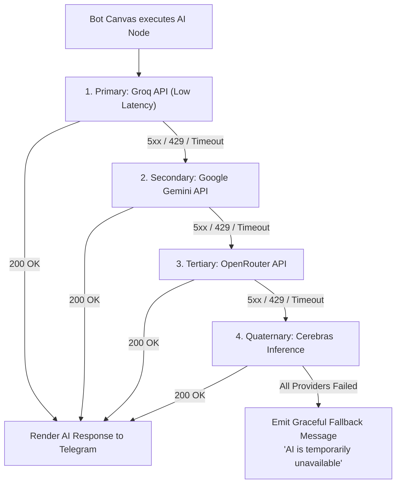
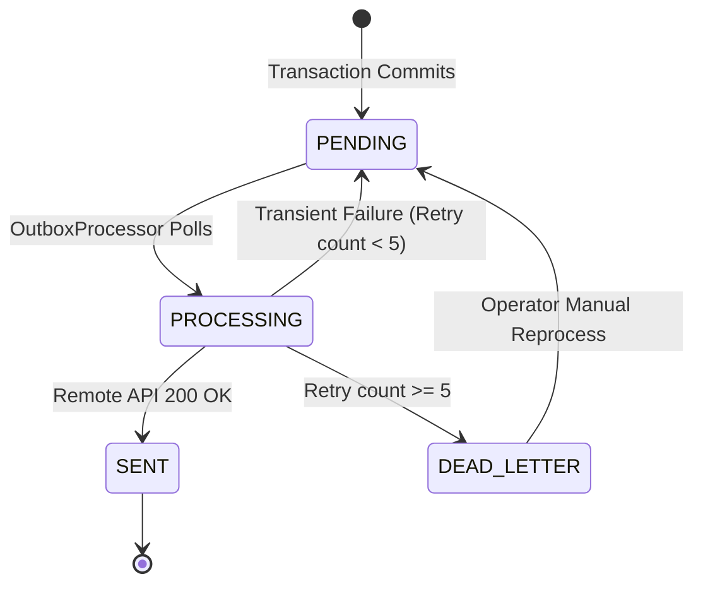

# Failure Modes, Resilience & Disaster Recovery Runbook

| Metadata | Value |
|---|---|
| Target System | Launchly Telegram Automation & Omnichannel Platform |
| Classification | Operational Reliability & Incident Recovery Runbook |
| Target SLA | 99.9% Uptime, Zero-Loss Event Delivery |
| Scope | AI Failovers, Telegram Rate Limits, Outbox DLQ, Redis Outages |

---

## 1. Multi-Provider AI Fallback Ladder

### Failure Scenario
The conversational bot canvas invokes an AI node using Groq (`llama-3.3-70b-versatile`). Groq API experiences an outage, 503 Service Unavailable, or 429 Rate Limit Exceeded.

### Resilience Architecture
Launchly implements a multi-tier fallback ladder via `AiFallbackRouterService`:



### Recovery & Circuit Breakers
- Each provider client is encapsulated with a **Resilience4j Circuit Breaker**.
- If a provider fails 5 consecutive times within a 60-second window, the circuit opens for 3 minutes, automatically bypassing that provider and saving roundtrip latency.
- Health probe queries periodically test provider recovery.

---

## 2. Telegram Bot API Throttling & Outbox DLQ

### 2.1 The 429 "Too Many Requests" Spike
**Failure Scenario**: A mass broadcast campaign of 50,000 recipients triggers simultaneous sends, exceeding Telegram's global limit (30 messages per second) or per-chat limit (1 message per second). Telegram returns `HTTP 429 Too Many Requests` with a `retry_after: N` response parameter.

**Resilience & Recovery**:
1. **Dynamic Throttling**: The broadcast engine reads `parameters.retry_after` from the Telegram error body.
2. **Worker Backoff**: The dispatch worker sleeps the tenant's broadcast thread for $N$ seconds + 100ms jitter.
3. **Queue Rescheduling**: Unsent messages remain safely staged in the database with status `PENDING`.

### 2.2 Bot Blocked by User (HTTP 403 Forbidden)
**Failure Scenario**: When sending a message to a Telegram chat ID, Telegram responds with `403 Forbidden: bot was blocked by the user`.

**Recovery**:
- Launchly immediately marks the `BotUser` record as `is_blocked = true` and `unsubscribed_at = NOW()`.
- The Outbox event is marked as `RESOLVED_BLOCKED` to stop subsequent retry loops and eliminate wasted API quota.

### 2.3 Transactional Outbox Dead Letter Queue (DLQ)
All asynchronous notifications, webhooks, and Telegram dispatches are persisted to the `outbox_events` table within the originating business transaction.



#### Manual DLQ Reprocessing Runbook:
1. **Inspect Dead Letter Events**:
   ```sql
   SELECT id, event_type, payload, last_error, retry_count, updated_at 
   FROM outbox_events 
   WHERE status = 'DEAD_LETTER' 
   ORDER BY updated_at DESC LIMIT 50;
   ```
2. **Resolve Root Cause** (e.g., renew expired Telegram bot token, re-establish external webhook URL).
3. **Trigger Batch Re-drive**:
   ```sql
   UPDATE outbox_events 
   SET status = 'PENDING', retry_count = 0, next_retry_at = NOW() 
   WHERE status = 'DEAD_LETTER' AND event_type = 'TELEGRAM_OUTBOUND';
   ```

---

## 3. Redis Cache & Lock Outage Degradation

### Failure Scenario
The Redis master container restarts or network partitions disrupt connections to port 6379.

### Graceful Degradation Strategy:
1. **Dynamic Rate Limiting**: The `TierRateLimitFilter` catches `RedisConnectionFailureException`. Instead of throwing a 500 Internal Server Error, the filter logs a high-severity warning and allows requests through in **Permissive Mode** to preserve system availability.
2. **Token Blacklist**: If Redis is unreachable, JWT validation continues using local cryptographic signature verification, temporarily bypassing the revocation blacklist check until Redis reconnects.
3. **Health Probes**: Spring Boot Actuator `/actuator/health` marks Redis as `DEGRADED` without terminating the container.

---

## 4. Database Connection Pool Exhaustion & Recovery

### Failure Scenario
A burst of complex CRM search queries or large JSONB flow serialization locks all 20 HikariCP connections, causing incoming requests to throw `SQLTransientConnectionException: Connection is not available, request timed out after 20000ms`.

### Recovery Runbook:
1. **Identify Long-Running Transactions in PostgreSQL**:
   ```sql
   SELECT pid, now() - pg_stat_activity.query_start AS duration, query, state
   FROM pg_stat_activity
   WHERE (now() - pg_stat_activity.query_start) > interval '10 seconds'
     AND state != 'idle';
   ```
2. **Terminate Hanging Query**:
   ```sql
   SELECT pg_terminate_backend(pid);
   ```
3. **Verify HikariCP Leak Detection**: Look for `Apparent connection leak detected` in Logback logs to locate methods missing `@Transactional` timeouts or performing remote I/O within a transaction.
