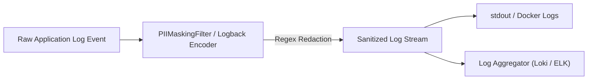
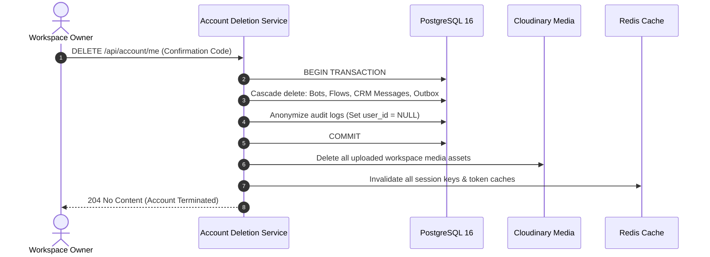

# Privacy, GDPR & Data Protection Specification

| Metadata | Value |
|---|---|
| Target Platform | Launchly SaaS Multi-Tenant Platform |
| Compliance Standard | GDPR (EU 2016/679) / SOC 2 Type II Security & Privacy Principles |
| Document Classification | Legal & Engineering Compliance Specification |
| Data Protection Officer Contact | privacy@launchly.app |

---

## 1. Data Classification Hierarchy

Launchly classifies all stored and transmitted data into strict sensitivity categories to ensure proportional cryptographic and operational safeguards:

| Classification Level | Data Types | Encryption in Transit | Encryption at Rest | Retention Policy |
|---|---|---|---|---|
| **Tier 1: Public** | Documentation, blog posts, marketing templates. | TLS 1.3 / HTTPS | Standard EBS / SSD | Indefinite |
| **Tier 2: Operational** | Bot flow node positions, campaign execution stats, server metrics. | TLS 1.3 | AES-256 (PostgreSQL) | Indefinite |
| **Tier 3: Confidential** | Workspace configurations, Google Sheets OAuth tokens, Mailchimp API keys. | TLS 1.3 | AES-256 + Vault/Env | Lifetime of account |
| **Tier 4: PII / Restricted** | Customer Telegram usernames, phone numbers, live CRM chat transcripts, user emails. | TLS 1.3 | AES-256 | Configurable by workspace tier |

---

## 2. Automated PII Masking in Observability Pipelines

To satisfy GDPR Article 32 and prevent accidental leakage of sensitive credentials or customer identifiers into log aggregators (Elasticsearch, Datadog, Grafana Loki), Launchly enforces an in-memory **PII Scrubbing Pipeline**:

### Scrubbing Invariants:
1. **Email Addresses**: Converted to `u***r@d***n.com`.
2. **Phone Numbers**: Converted to `+380******99`.
3. **Bearer & API Tokens**: HTTP `Authorization: Bearer <token>` and `bot<token>` strings replaced with `[REDACTED_SECRET]`.
4. **Credit Cards**: Any 16-digit sequence matching the Luhn algorithm replaced with `[REDACTED_PAN]`.

---

## 3. Right to be Forgotten (GDPR Article 17)

When a customer or workspace owner exercises their right to data erasure, Launchly guarantees complete and irreversible removal across all persistence layers within 30 days:

---

## 4. Third-Party Subprocessors & International Transfers

Launchly strictly vets and limits third-party subprocessors handling customer data:

| Subprocessor | Purpose | Data Transferred | Data Processing Agreement (DPA) |
|---|---|---|---|
| **Stripe, Inc.** | Payment processing & subscriptions | Email, billing address, tokenized card | Standard Contractual Clauses (SCC), PCI-DSS Level 1 |
| **Cloudinary Ltd.** | Media storage & CDN delivery | User-uploaded images, videos, audio | Standard Contractual Clauses (SCC) |
| **Telegram FZ-LLC** | Bot messaging delivery | Telegram User ID, message text | Telegram Bot Terms of Service |
| **Groq, Inc.** | High-speed LLM inference | Conversational prompt context | Enterprise Zero-Data Retention DPA |
| **Google Cloud** | Gemini AI inference & OAuth SSO | Prompt context, user email | Google Cloud Enterprise DPA |
