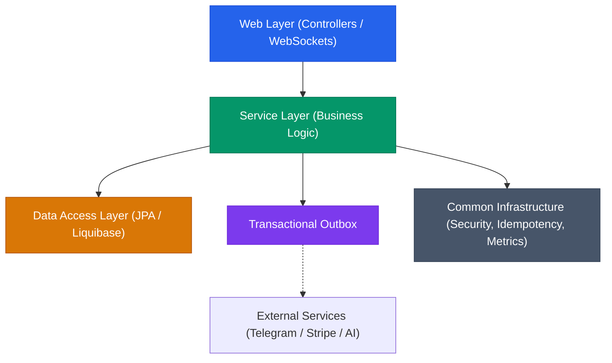

# Launchly — Repository & Subsystem Structure

| Metadata | Value |
|---|---|
| Target Platform | Telegram Bot Builder & Multi-Channel CRM SaaS |
| Monorepo Architecture | Modular Monolith (Backend) + Layered SPA (Frontend) + Load Harness |
| Document Classification | Engineering Architecture Specification |

---

## 1. Monorepo Organization

The Launchly repository is structured as a unified monorepo segregating backend services, frontend web application, load testing suites, and operations configurations:

```
launchly/
├── .github/
│   └── workflows/              # CI/CD pipelines (checks.yml, deploy.yml)
├── backend/                    # Spring Boot 4.x / Java 21 enterprise service
│   ├── src/main/java/com/launchly/
│   └── src/main/resources/     # Liquibase migrations, application profiles
├── frontend/                   # React 19 / TypeScript / Vite 8 client
│   ├── src/                    # Feature slices, React Flow canvas, STOMP client
│   └── public/                 # Static assets, favicon, brand graphics
├── load-tests/                 # Grafana k6 high-concurrency stress test suite
│   ├── src/scenarios/          # 17 load scenarios (CRM, Telegram, Outbox, AI)
│   └── reports/                # HTML performance audit reports
├── docs/                       # Engineering specifications and architecture hub
│   ├── adr/                    # Architecture Decision Records (ADR-001..010)
│   ├── modules/                # Subsystem technical specifications
│   ├── specs/                  # Wire protocols & JSON schemas
│   └── deployment/             # Multi-stage Docker, Nginx, CI/CD runbooks
├── agent/                      # AI pair-programming rules, roadmap, and guidelines
├── docker-compose.prod.yml     # Production multi-service orchestration
└── sonar-project.properties    # SonarCloud static analysis configuration
```

---

## 2. Backend Package Architecture (`backend/`)

The backend follows **Package-by-Feature** modular design coupled with **Clean Architecture** boundaries. Each business domain encapsulates its own Web (Controllers), Domain/Application (Services, DTOs, Mappers), and Persistence (Entities, Repositories):

```
backend/src/main/java/com/launchly/
├── admin/                      # Platform administration, tenant management, system audits
├── ai/                         # Multi-provider LLM failover router (Groq, Gemini, OpenRouter, Cerebras)
│   ├── client/                 # External HTTP clients with resilience wrappers
│   ├── controller/             # AI generation and prompt testing endpoints
│   └── service/                # Fallback ladder orchestration and token budget tracker
├── analytics/                  # Bot interaction aggregates, delivery funnel metrics
├── auth/                       # Spring Security 7, JWT lifecycle, Google OAuth2 SSO
│   ├── security/               # Custom UserDetails, JWT Authentication Filter
│   └── service/                # Auth token generation, blacklist, refresh token rotation
├── billing/                    # Stripe subscription checkout, billing portal, webhook ingestion
├── blog/                       # Public content marketing and changelog CMS
├── bot/                        # Conversational visual flow builder & execution engine
│   ├── executor/               # Polymorphic NodeExecutors (Message, AI, Conditions, Actions)
│   ├── handler/                # Media block processors (Text, Image, Video, Audio, File)
│   ├── action/                 # Integration handlers (Google Sheets, Mailchimp, CRM tags)
│   └── service/                # FlowSchema JSONB engine, Telegram webhook dispatcher
├── broadcast/                  # High-volume campaign broadcaster, batching & rate throttling
├── common/                     # Cross-cutting enterprise infrastructure
│   ├── config/                 # Virtual threads, STOMP WebSocket, Jackson, Redis configs
│   ├── idempotency/            # Redis distributed lock aspect & replay filter
│   ├── outbox/                 # Transactional Outbox pattern engine, scheduler & DLQ
│   ├── ratelimit/              # Dynamic tier token-bucket rate limiter & filter
│   ├── security/               # PII log masking, Turnstile verification, CORS/CSP
│   └── validation/             # Custom annotations and DTO validators
├── crm/                        # Omnichannel CRM, live inbox, customer profiling
│   ├── websocket/              # Real-time STOMP notification service
│   ├── event/                  # Internal Spring ApplicationEvents (Order, Lead, Message)
│   └── scheduler/              # Automated lead status transitions and SLA monitors
├── integration/                # External webhook endpoints and third-party SaaS connectors
├── media/                      # Cloudinary media transformation, asset uploads, CDN proxy
├── notification/               # In-app alerts, transactional emails, system push
└── support/                    # Helpdesk ticketing and customer inquiry queues
```

---

## 3. Frontend Architecture (`frontend/`)

The frontend is an enterprise single-page application built with React 19, Vite, and Tailwind CSS v4, divided into layered feature domains:

```
frontend/src/
├── api/                        # Axios HTTP client, idempotency interceptors, auth refresh
├── assets/                     # Icons, SVGs, static media
├── components/                 # Reusable UI primitives (buttons, modals, tables, forms)
├── contexts/                   # Global React contexts (theme, toast, notifications)
├── features/                   # Domain-driven feature slices
│   ├── auth/                   # Login, register, Google OAuth callback, Turnstile widget
│   ├── bot-builder/            # React Flow interactive canvas, custom nodes, edge router
│   ├── crm/                    # Omnichannel inbox, virtualized message thread, lead drawers
│   ├── broadcasts/             # Campaign wizard, recipient filters, delivery analytics
│   ├── billing/                # Subscription plans, Stripe checkout, invoice history
│   └── settings/               # Workspace members, API keys, webhook configurations
├── hooks/                      # Custom hooks (STOMP WebSocket subscriptions, windowing)
├── layouts/                    # Dashboard layout, public landing layout, auth layout
├── routes/                     # React Router v7 configuration and RBAC route guards
├── stores/                     # Zustand v5 synchronous stores (session, active canvas, UI)
└── utils/                      # DOMPurify sanitization, date formatters, math utilities
```

---

## 4. Architectural Boundary Rules

To preserve codebase modularity and prevent spaghetti dependencies, all contributions must respect the following invariant rules:



1. **No Inter-Domain Direct Database Writes**: A service in domain `crm` cannot modify tables belonging to `billing` directly. Inter-domain mutations must be orchestrated via domain events or transactional outbox.
2. **Open-in-View is Disabled**: `spring.jpa.open-in-view=false` is enforced. All entity relations must be loaded using JPA Entity Graphs (`@EntityGraph`) or specific DTO projections in the repository layer to eliminate N+1 queries.
3. **External Network Calls Outside DB Transactions**: Never perform HTTP requests (Telegram Bot API, Stripe, Groq AI) inside a `@Transactional` block. Long network calls lock database connections from the HikariCP pool.
4. **Idempotency on Critical Mutations**: Endpoints executing financial operations (Stripe), broadcast launches, or webhook processing must annotate methods with `@Idempotent`.
