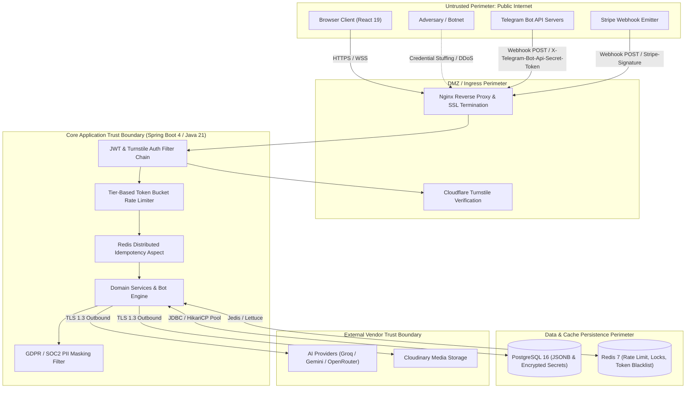
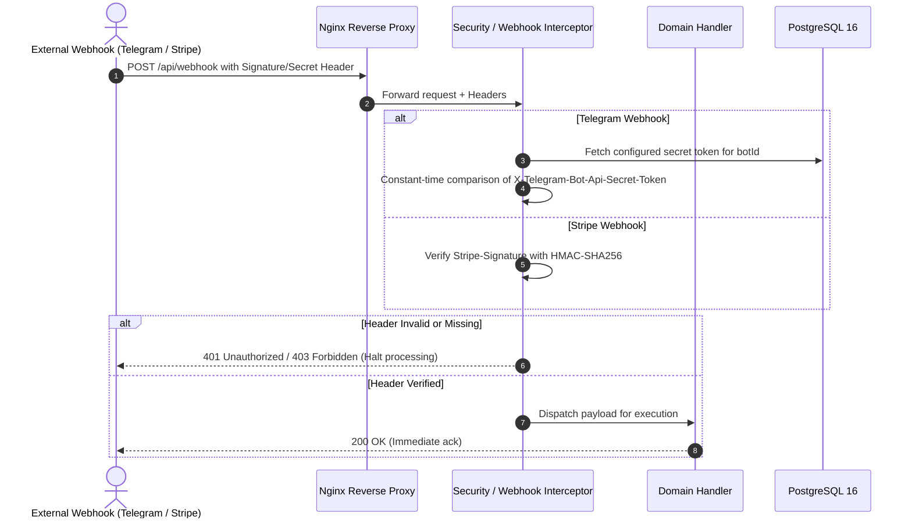

# Threat Model & Security Architecture

| Metadata | Value |
|---|---|
| Target System | Launchly SaaS Platform (Telegram Bot Engine & CRM) |
| Framework | STRIDE / Microsoft Threat Modeling Process |
| Document Version | 1.0.0 |
| Document Classification | Enterprise Security Architecture Specification |

---

## 1. System Overview & Trust Zones

Launchly handles sensitive user credentials, Telegram bot tokens, customer CRM chat histories, payment details (Stripe), and external third-party integrations (Google Sheets, Mailchimp). Communication crosses public perimeters and third-party SaaS ecosystems:

---

## 2. STRIDE Threat Analysis & Mitigations

The STRIDE model categorizes potential threat vectors against Launchly components:

| STRIDE Category | Threat Scenario | Impact | Launchly Mitigation & Security Control |
|---|---|---|---|
| **S**poofing | Attacker sends fake Telegram update to `/api/telegram/webhook/{botId}`. | Inject malicious conversation updates, trigger automated node execution. | Every webhook registration configures a cryptographically random `X-Telegram-Bot-Api-Secret-Token`. Inbound requests validate this header before deserialization. |
| **S**poofing | Attacker replays stolen or intercepted JWT tokens. | Unauthorized access to tenant dashboard and CRM messages. | Stateless short-lived JWT access tokens (15 minutes). Refresh token rotation with Redis-backed immediate revocation blacklist. |
| **S**poofing | Forged Stripe checkout completion events. | Free activation of PRO/ENTERPRISE subscriptions. | Ingestion endpoint cryptographically verifies `Stripe-Signature` against the webhook secret using `Webhook.constructEvent`. |
| **T**ampering | Horizontal Privilege Escalation: User A modifies Bot or Flow of User B by altering `botId` in request path. | Data breach, unauthorized modification of conversational flows. | `BotAccessValidator` intercepts requests, enforcing tenant/workspace role scoping: user must possess `OWNER` or `ADMIN` role for the targeted workspace. |
| **T**ampering | XSS payload stored in CRM incoming message and rendered in agent dashboard. | Session hijacking of CRM live agents. | Strict sanitization via `DOMPurify` before DOM rendering; strict Content Security Policy (`CSP`) headers on frontend; input validation DTOs. |
| **R**epudiation | Malicious administrator deletes bot or exports user database without trace. | Inability to audit unauthorized administrative operations. | Comprehensive audit trails with correlation IDs (`X-Request-ID`) recorded across all state-mutating endpoints. |
| **I**nformation Disclosure | Logging pipelines inadvertently output bot tokens, customer phone numbers, or passwords. | PII breach, compliance failure (GDPR / SOC2). | Custom `PIIMaskingFilter` and Logback regex patterns automatically redact emails, credit cards, bearer tokens, and phone numbers in stdout and logs. |
| **I**nformation Disclosure | Database dump leaks plaintext Telegram Bot tokens or Stripe secrets. | Unauthorized control of client bots and communication channels. | Encrypted at rest. Database access restricted by isolated VPC; credentials loaded via environment variables / secret stores. |
| **D**enial of Service | Botnets flood `/api/auth/register` and `/api/auth/login` with credential stuffing. | CPU starvation, database connection exhaustion. | Server-side mandatory **Cloudflare Turnstile** token verification (`cloudflare.turnstile.verify-url`) prior to credential validation. |
| **D**enial of Service | High-concurrency spam triggers unbounded AI LLM completions, exhausting API balances. | Financial loss, service denial for legitimate workspace users. | Dynamic tier-based token bucket rate limiter (`TierRateLimitFilter`) backed by Redis. Circuit breakers (`Resilience4j`) throttle outbound AI calls. |
| **E**levation of Privilege | Member role attempts to perform destructive billing or team deletion actions. | Unauthorized workspace takeover. | `@PreAuthorize` method security enforcement checking `WorkspaceRole` hierarchy (`OWNER` > `ADMIN` > `MEMBER` > `AGENT`). |

---

## 3. Webhook Cryptographic Verification Architecture

---

## 4. Secret & Token Management Matrix

| Secret Type | Storage Location | Rotation Procedure | Exposure Surface |
|---|---|---|---|
| JWT Signing Key | Environment Variable (`JWT_SECRET`) | Scheduled 90-day rotation; invalidates active refresh tokens. | Backend memory only; never transmitted to clients. |
| Telegram Bot Tokens | PostgreSQL (`bots.token`) | Re-generated in @BotFather; updated via authenticated API. | Never logged (scrubbed by `PIIMaskingFilter`). |
| Stripe Webhook Secret | Environment Variable (`STRIPE_WEBHOOK_SECRET`) | Configured in Stripe Dashboard on endpoint recreation. | Backend memory only. |
| AI Provider Keys | Environment Variables (`GROQ_API_KEY`, `GEMINI_API_KEY`) | Rotated via cloud provider IAM consoles. | Backend outbound HTTP headers only. |
| Turnstile Secret Key | Environment Variable (`CLOUDFLARE_TURNSTILE_SECRET_KEY`) | Managed in Cloudflare Dashboard. | Backend server-to-server verification endpoint. |
