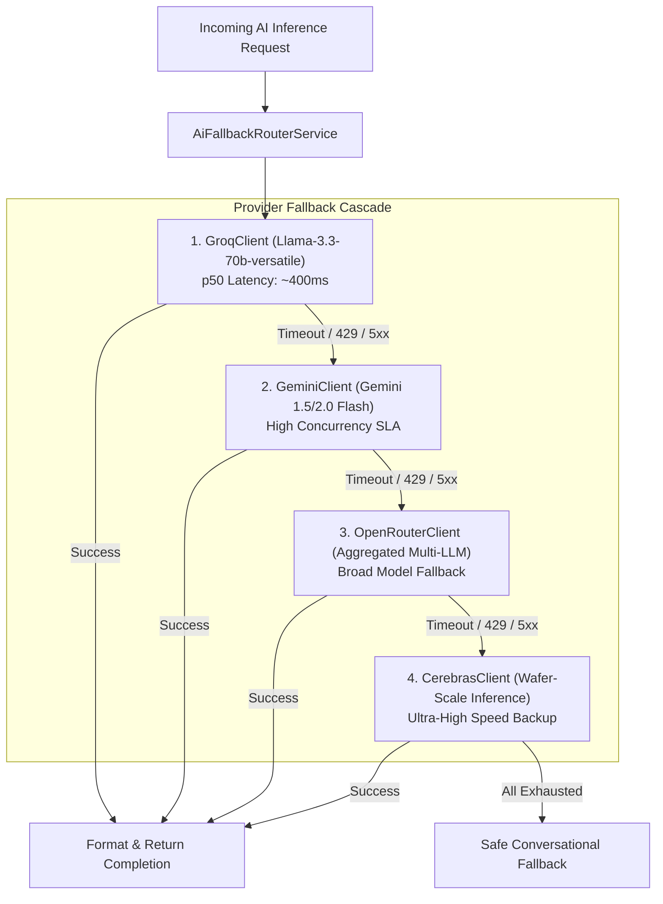

# Subsystem: Multi-Provider AI Fallback Router

| Metadata | Value |
|---|---|
| Target Package | `backend/com/launchly/ai/` |
| Primary Clients | `GroqClient`, `GeminiClient`, `OpenRouterClient`, `CerebrasClient` |
| Fallback Sequence | Groq $\to$ Google Gemini $\to$ OpenRouter $\to$ Cerebras |
| Fault Tolerance | Resilience4j Circuit Breaker & Retry backoff |

---

## 1. Architectural Responsibility

The **AI Router** provides high-availability, low-latency LLM completions for:
- Automated conversational responses in `AiNodeExecutor`.
- Flow Generation: synthesizing complete bot graphs from natural language prompts.
- Tone analysis, sentiment detection, and automated customer qualification.

---

## 2. Dynamic Failover Ladder

---

## 3. Resilience4j Circuit Breaker Configuration

To prevent cascading latencies when an external provider experiences degraded performance, each client is guarded with an isolated circuit breaker:

| Parameter | Value | Description |
|---|---|---|
| `slidingWindowSize` | 10 requests | Evaluation window for calculating error percentage. |
| `failureRateThreshold` | 50% | Trip threshold: opens circuit if 5 out of 10 calls fail. |
| `waitDurationInOpenState` | 60 seconds | Cool-off duration before probing provider recovery. |
| `slowCallDurationThreshold` | 4,000ms | Calls exceeding 4s are counted as slow/failing calls. |
