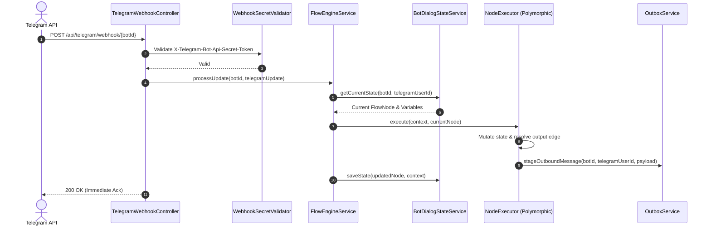

# Subsystem: Bot Flow Execution Engine

| Metadata | Value |
|---|---|
| Target Package | `backend/com/launchly/bot/` |
| Primary Services | `FlowEngineService`, `BotDialogStateService`, `TelegramWebhookService` |
| Concurrency Model | Loom Virtual Threads per webhook update |
| Storage | PostgreSQL `flow_schemas` (JSONB) |

---

## 1. Architectural Responsibility

The **Bot Engine** is the core conversational processor of Launchly. It is responsible for:
- Ingesting Telegram Webhook updates via `TelegramWebhookController`.
- Deserializing and executing conversational graph definitions stored in `FlowSchema`.
- Maintaining conversational session state (`BotDialogStateService`) across user interactions.
- Orchestrating polymorphic node executors (Conditions, Actions, Media Blocks, AI generation).
- Asynchronously dispatching outbound Telegram API calls through the Transactional Outbox.

---

## 2. Ingestion & Execution Pipeline



---

## 3. Polymorphic Node Executors

Each node type in the graph is processed by a dedicated Spring bean implementing `NodeExecutor`:

```
backend/com/launchly/bot/executor/
├── StartNodeExecutor.java             # Matches /start, deep link referral params
├── MessageNodeExecutor.java           # Renders text, keyboards, and media blocks
├── ConditionNodeExecutor.java         # Variable comparison (EQUALS, CONTAINS, GTE, REGEX)
├── ActionNodeExecutor.java            # Side-effects (Google Sheets, Mailchimp, CRM tags)
├── AiNodeExecutor.java                # LLM completion via AiFallbackRouterService
├── InputNodeExecutor.java             # Awaits user reply; validates email, phone, regex
├── CooldownNodeExecutor.java          # Rate-limits repeated node access per user
├── SmartDelayNodeExecutor.java        # Schedules delayed resume via FlowDelayScheduler
├── ModerationNodeExecutor.java        # Profanity & spam moderation engine
├── LeadNodeExecutor.java              # CRM lead creation and qualification scoring
└── OrderNodeExecutor.java             # In-bot e-commerce purchase orchestration
```

---

## 4. State Persistence & Call Stack

User session state is preserved in the `bot_users` table and `FlowSchemaCache`:
- **Variables Map**: A native JSONB object containing collected user attributes (`email`, `cart_total`, `lead_status`).
- **CallStack**: Managed by `BotCallStackManager`, allowing conversational flows to branch into reusable sub-flows and cleanly return to the parent execution context.
