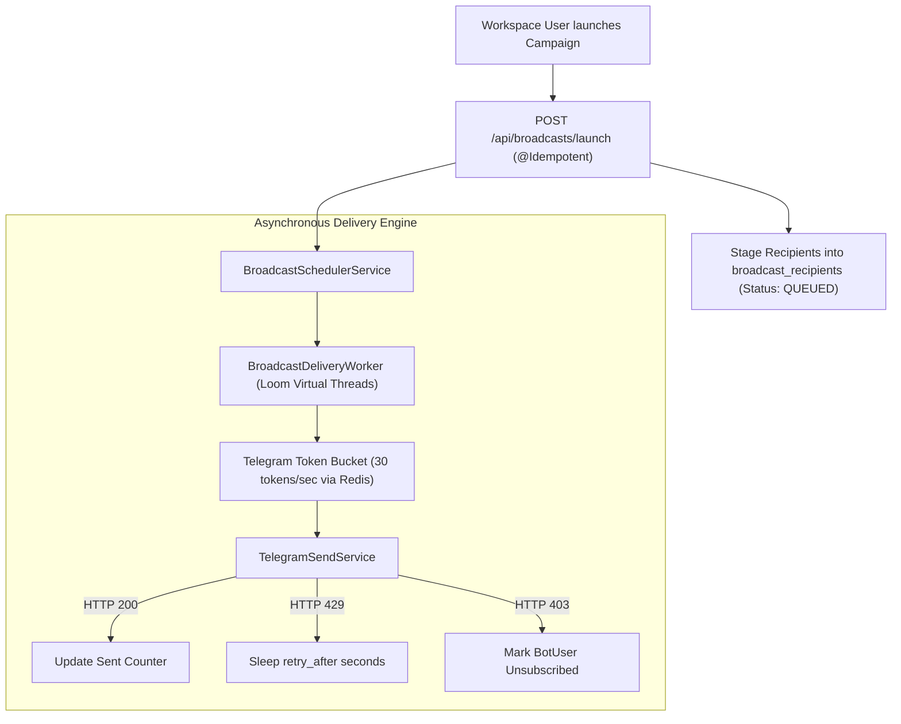

# Subsystem: Broadcast Campaigns & Mass Messaging

| Metadata | Value |
|---|---|
| Target Package | `backend/com/launchly/broadcast/` |
| Primary Components | `BroadcastService`, `BroadcastSchedulerService`, `BroadcastDeliveryWorker` |
| Throughput Envelope | Up to 30 messages/sec per Telegram Bot Token |
| State Guarantee | Transactional Outbox + Redis Sliding Window Throttler |

---

## 1. Architectural Responsibility

The **Broadcast Subsystem** manages high-volume marketing, transactional announcements, and segment-targeted campaign execution across thousands of Telegram users.

Key requirements:
- **Audience Segmentation**: Filtering users by tags, language, activity date, and funnel status.
- **Telegram Rate Compliance**: Telegram enforces strict API limits:
  - Max 30 messages per second globally across a single bot.
  - Max 1 message per second to any specific user.
- **Delivery Funnel Observability**: Real-time tracking of `QUEUED`, `SENT`, `DELIVERED`, `FAILED`, and `BLOCKED` states.

---

## 2. Broadcast Execution Pipeline

---

## 3. Database Optimization & JDBC Batching

Staging 50,000 campaign recipients one-by-one causes significant database lock contention. Launchly leverages Hibernate JDBC statement batching (`hibernate.jdbc.batch_size=50`):
- Recipients are inserted in batches of 50 records per SQL statement.
- Status updates (`SENT`, `FAILED`) are batched during delivery sweeps, eliminating single-row database churn.
