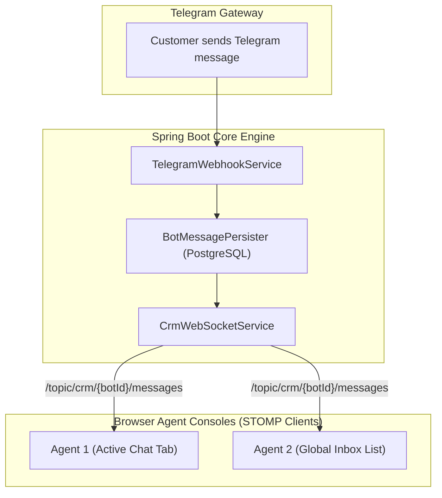

# Subsystem: Omnichannel CRM & Live Inbox

| Metadata | Value |
|---|---|
| Target Package | `backend/com/launchly/crm/` |
| Primary Components | `CrmWebSocketService`, `ConversationService`, `LeadService` |
| Real-Time Layer | Spring STOMP over SockJS (`/topic/crm/{botId}/...`) |
| Frontend Components | `features/crm/`, TanStack Virtual List |

---

## 1. Architectural Responsibility

The **CRM Inbox** provides multi-tenant live customer communication and lead pipeline management. It bridges automated bot interactions with human operator interventions:
- **Two-Way Live Chat**: Real-time message streaming over WebSockets between agents and Telegram end-users.
- **Operator Interruption / Takeover**: Allows support agents to pause automated bot execution and take manual control of a user thread.
- **Lead Pipeline Management**: Kanban/table lead management with stages (`NEW`, `QUALIFIED`, `IN_PROGRESS`, `WON`, `LOST`).
- **High-Volume Windowing**: Virtualized message and contact rendering capable of displaying 50,000+ conversation records with zero DOM degradation.

---

## 2. Real-Time Event Fan-Out

---

## 3. Human Operator Takeover Protocol

1. **State Mutation**: When an agent clicks "Take Over", an authenticated HTTP request is sent: `POST /api/crm/conversations/{id}/takeover`.
2. **Lockout Flag**: `bot_user.is_operator_controlled` is set to `true`.
3. **Bot Engine Bypass**: Inbound messages skip flow graph evaluation and append directly to the active CRM conversation thread.
4. **Resolution**: When the operator clicks "Resolve Thread", `is_operator_controlled` reverts to `false`, allowing the bot engine to resume handling customer input.
