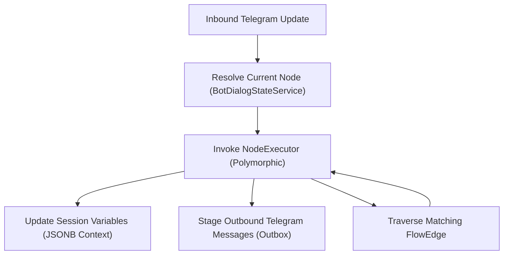

# Specification: Bot Conversational Flow Graph (JSON AST)

| Metadata | Value |
|---|---|
| Target Component | `backend/com/launchly/bot/` & `frontend/features/bot-builder/` |
| Serialization Format | PostgreSQL `JSONB` / JSON RFC 8259 |
| Version | 2.1.0 |
| Standard | FlowSchema Specification |

---

## 1. Overview & Data Model

The conversational logic for any Launchly bot is defined as a Directed Acyclic Graph (DAG) with loopable sub-branches, represented as a JSON Abstract Syntax Tree (AST). Stored within the `flow_schemas` table, the document contains two primary arrays: `nodes` and `edges`.

```json
{
  "id": "schema-9842a",
  "version": "2.1.0",
  "viewport": { "x": 120.5, "y": 45.0, "zoom": 1.0 },
  "nodes": [ ... ],
  "edges": [ ... ]
}
```

---

## 2. Node Schema Definition

Each node inside `nodes[]` represents an atomic conversational step, conditional evaluator, or external side effect.

### Base Node Schema (`FlowNode`)

```json
{
  "id": "node-uuid-1",
  "type": "MESSAGE | CONDITION | ACTION | AI | INPUT | DELAY | START",
  "position": {
    "x": 250.0,
    "y": 140.0
  },
  "data": {
    "title": "Welcome Greeting",
    "description": "Initial message sent upon /start",
    "config": { ... }
  }
}
```

### Node Types Catalog:

| Node Type | Purpose | Key `config` Properties |
|---|---|---|
| `START` | Entry point for trigger commands (`/start`, deep links). | `command`: String (e.g. `"/start"`), `triggerType`: `"COMMAND" \| "KEYWORD" \| "NEW_USER"`. |
| `MESSAGE` | Dispatches rich text, inline keyboards, or media blocks to Telegram. | `messageBlocks`: Array of blocks (Text, Image, Video, Audio, File, Delay). |
| `CONDITION` | Evaluates user variables, tags, or regex to branch execution. | `rules`: `[ { "field": "user.age", "operator": "GTE", "value": "18" } ]`, `matchType`: `"ALL" \| "ANY"`. |
| `ACTION` | Executes external side effects without user interaction. | `actionType`: `"ASSIGN_TAG" \| "GOOGLE_SHEETS" \| "MAILCHIMP" \| "NOTIFY_AGENT"`. |
| `AI` | Prompts external LLM via the Multi-Provider Router. | `systemPrompt`: String, `userPrompt`: String, `temperature`: Float, `outputVariable`: String. |
| `INPUT` | Waits for user input, validating against types. | `validationType`: `"ANY" \| "EMAIL" \| "PHONE" \| "NUMBER" \| "REGEX"`, `variableName`: String. |
| `DELAY` | Pauses flow execution asynchronously. | `durationSeconds`: Integer, `dynamicSchedule`: Boolean. |

---

## 3. Edge Schema Definition (`FlowEdge`)

Edges define directional transitions between nodes, bound to specific output source handles:

```json
{
  "id": "edge-1-to-2",
  "source": "node-uuid-1",
  "sourceHandle": "btn_continue",
  "target": "node-uuid-2",
  "targetHandle": "input_target",
  "data": {
    "label": "User clicked Continue",
    "conditionResult": "TRUE"
  }
}
```

---

## 4. Execution State Machine & Call Stack

When an update arrives from Telegram, `FlowEngineService` evaluates the flow state:



- **Call Stack Isolation**: Sub-flows or modular templates push a `CallStackFrame` onto `BotCallStackManager`.
- **Loop Guards**: A single execution step is capped at **25 sequential non-blocking nodes** to prevent infinite traversal cycles.
